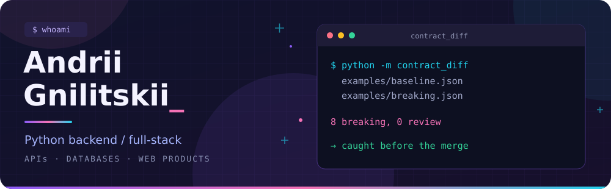

  

  
  
  
   
  
  
  

### Behind the terminal

I'm Andrii, a backend developer with 6 years of commercial experience. Most days that means Python, APIs, integrations, and PostgreSQL. I also work with TypeScript when a feature crosses into the frontend.

I like projects where I can follow a problem all the way through: the API contract, the database query, and what the user actually sees.

### Things you can open

| Repository | What is inside |
| --- | --- |
| 🐍 [api-contract-diff](https://github.com/andriignilitskii-netizen/api-contract-diff) | An offline Python CLI for checking OpenAPI changes. Separate rules for requests and responses, local refs, and reports for CI. [Start with the example report](https://github.com/andriignilitskii-netizen/api-contract-diff/blob/main/examples/report.md). |
| ⚡ [vue-examples](https://github.com/andriignilitskii-netizen/vue-examples) | Vue/Nuxt snippets for SSR pages, structured data, responsive images, and API calls. [Read the integration notes](https://github.com/andriignilitskii-netizen/vue-examples#integration-notes). |

Small repos, specific problems. The useful bits are in the code, the tests, and the notes about what each example leaves out.

  

